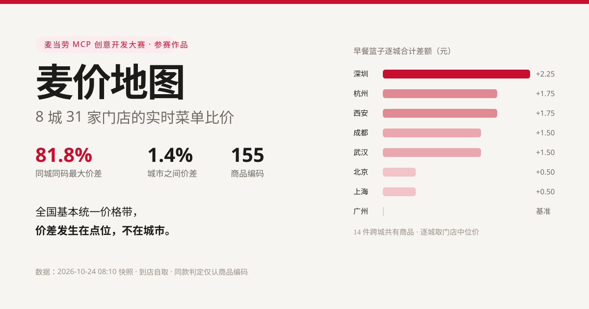

# 麦价地图 · McPrice Map

**用麦当劳官方 MCP 扫 8 个城市 31 家门店的实时菜单，回答一个问题：同一份东西，哪里更便宜。**



> 在线报告：[`index.html`](index.html)（单文件，无外部依赖，可直接 GitHub Pages 托管）

---

## 三条结论（基于 2026-10-24 08:10 的实测快照）

| # | 结论 | 数据 |
|---|---|---|
| 1 | **城市之间几乎同价** | 14 件早餐篮子逐城合计，8 城落在 **161.50–163.75 元**，极差 2.25 元（1.4%） |
| 2 | **同城不同点位差很多** | 同一商品编码「芝芝火腿扒堡组合」，深圳两家门店分别是 **9.9 元** 和 **18.0 元**（+81.8%） |
| 3 | **你想要的未必有** | 门店在售 **52–99 款**，同一时段同一城市内最多相差 42 款（成都） |

一句话：**全国基本统一价格带，真正的价差发生在你所在的那栋楼。**

最明显的点位溢价门店是深圳兴融二路（华融大厦）餐厅——55 个可比商品里 36 个高于同城中位价，累计贵 57.3 元。
写字楼、交通枢纽类门店的加价，比城市之间的差异大一个量级。

---

## 它解决什么问题

日常场景只有三种，都不需要打开麦当劳 App 一家家比：

- **想吃某个具体商品**：先确认附近哪家有（同城菜单宽度最多差 42 款，快取小站可能根本没有）
- **想省钱**：看看同城哪家在做活动价，别在多走 300 米和差 8 元之间瞎猜
- **写内容 / 做选题**：一条命令复现全部数据，价差、篮子、门店溢价都能重新算

**目标用户**：每天在写字楼、园区、交通枢纽解决一顿饭的人；做消费类内容的作者；想验证"连锁品牌统一定价"这个印象的人。

---

## 快速开始

### 1. 申请 MCP Token

到 <https://open.mcd.cn/mcp> 手机号登录 → 控制台 → 激活，免费。

### 2. 配置（WorkBuddy / 任意 MCP 客户端）

```json
{
  "mcpServers": {
    "mcd-mcp": {
      "type": "streamablehttp",
      "url": "https://mcp.mcd.cn",
      "headers": { "Authorization": "Bearer YOUR_MCP_TOKEN" }
    }
  }
}
```

### 3. 跑

```bash
export MCD_MCP_TOKEN=你的token

# 采集：8 城 × 4 店（城市与地标在 collect_batch.py 的 CITIES 里改）
python skill/scripts/collect_batch.py breakfast 4

# 分析：按商品编码建矩阵，算中位价与价差
python skill/scripts/analyze.py \
  --snap data/snapshot-20261024-am.json \
  --out  data/analysis.json

# 出报告：单文件 HTML
python skill/scripts/render.py \
  --analysis data/analysis.json \
  --out      index.html
```

只依赖 Python 3.9+ 标准库，不需要 `pip install` 任何东西。

### 只想看结论、不想跑

`data/snapshot-20261024-am.json` 是本次采集的原始快照，`data/analysis.json` 是算好的结果，`index.html` 是渲染好的报告。直接打开就能看。

---

## 目录结构

```
.
├─ README.md
├─ CONTEST_DECLARATION.md      参赛声明（官方原文，未改动）
├─ MCP_INTEGRATION.md          MCP 接入说明：用了哪些工具、怎么串
├─ mcp-config.example.json     脱敏配置示例
├─ workbuddy.md                WorkBuddy 开发对话记录
├─ devlog.md                   逐条操作日志（含被推翻的结论与返工原因）
├─ skill/
│  ├─ SKILL.md                 技能定义：给 Agent 的执行规则
│  └─ scripts/
│     ├─ mcd_client.py         MCP 最小客户端（streamable HTTP，仅标准库）
│     ├─ collect.py            单城市采集
│     ├─ collect_batch.py      多城市批量采集
│     ├─ analyze.py            比价矩阵与指标计算
│     └─ render.py             生成单文件 HTML 报告
├─ data/
│  ├─ snapshot-20261024-am.json   原始快照（8 城 31 店 155 编码）
│  └─ analysis.json               计算结果
├─ index.html                  报告成品（GitHub Pages 首页）
└─ images/preview.png
```

---

## 方法论

1. `query-nearby-stores`（`beType=1, searchType=2`）按城市 + 地标取门店，过滤 `businessStatus=true`，每城取最近 4 家
2. `query-meals`（`orderType=1, beType=1`）逐店拉当前时段在售菜单与价格
3. 本地按 **商品编码 `code`** 建矩阵；只有编码严格相等才算同款
4. 跨城篮子：取 8 城全覆盖的 14 个编码，逐城取门店中位价后求和
5. 门店溢价：该店可比商品中高于同城中位价的占比与累计差额

### 已知局限（写清楚比藏着有用）

- 只采集**到店自取**渠道，不含外送（外送有配送费与另一套定价，混在一起会让结论失效）
- 只采集**单一时段**（本次为早餐时段）。麦当劳按时段换菜单，正餐价格需另跑一次快照
- 每城 4 家门店，样本量属于"能说明现象"，不足以做城市级结论
- **套餐组成未逐项核验**。同名不同码的商品可能是不同规格（见下），组合类价差建议用 `query-meal-detail` 展开后再判读

### 一个必须写进方法论的坑

按商品**名称**比价会得出完全错误的结论：

| 名称 | 编码 | 价格 |
|---|---|---|
| 精选麦满分套餐 | 9900013410 | 13.5 元 |
| 精选麦满分套餐 | 9900013411 | 15.3 / 15.6 元 |
| 精选麦满分套餐 | 9900013409 | 28.5 元 |

三个编码、三个不同商品，名称一模一样。名称匹配会把 28.5 元的（双人份）和 13.5 元的（单人份）算成同款，得出「同款相差 111%」的假新闻。
本项目所有价差只认 `code`。

---

## 声明

本项目为麦当劳程序员节创意开发大赛参赛作品，由参赛者独立开发，**非麦当劳官方产品**。
项目输出仅供参考，不构成医疗、营养或其他专业建议；餐品信息、价格及供应状态以麦当劳官方渠道的实时结果为准。

参赛声明见 [CONTEST_DECLARATION.md](CONTEST_DECLARATION.md)。Token 仅从环境变量 `MCD_MCP_TOKEN` 读取，不进仓库、不进日志。
